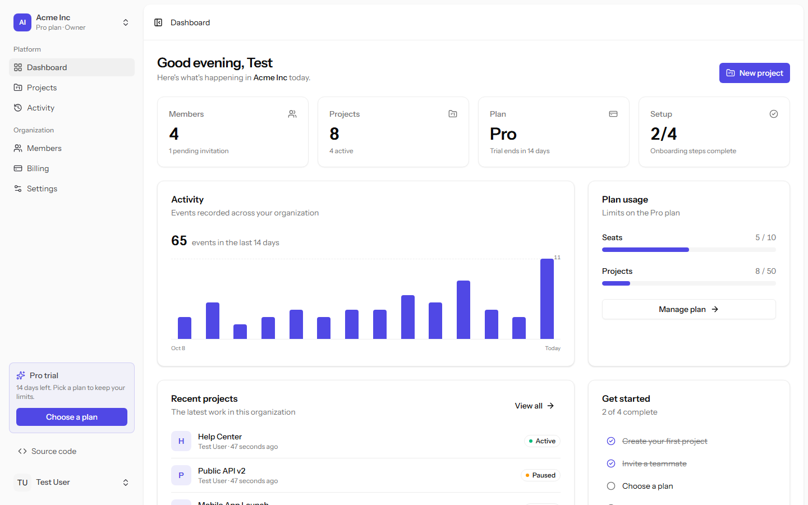
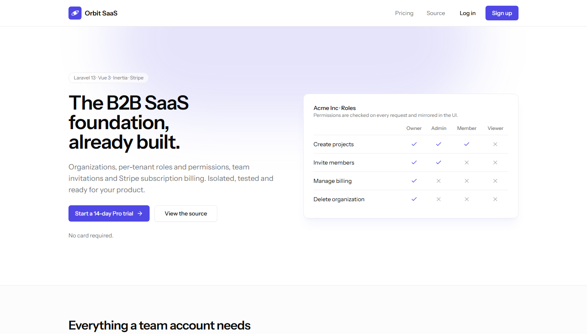
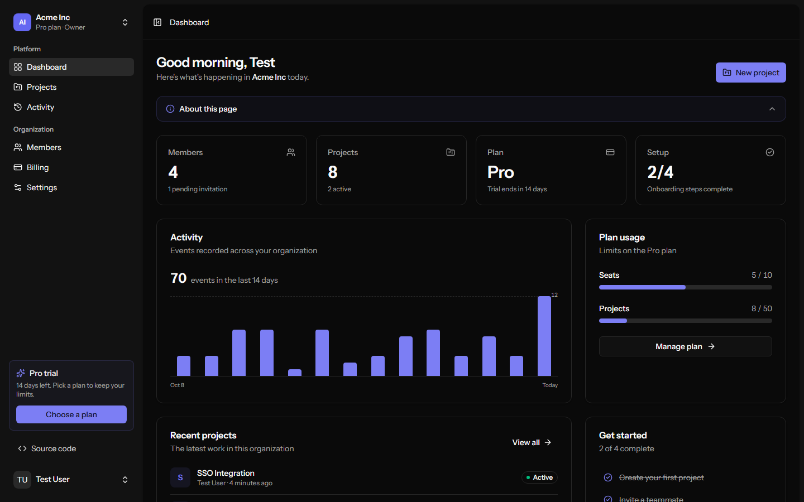
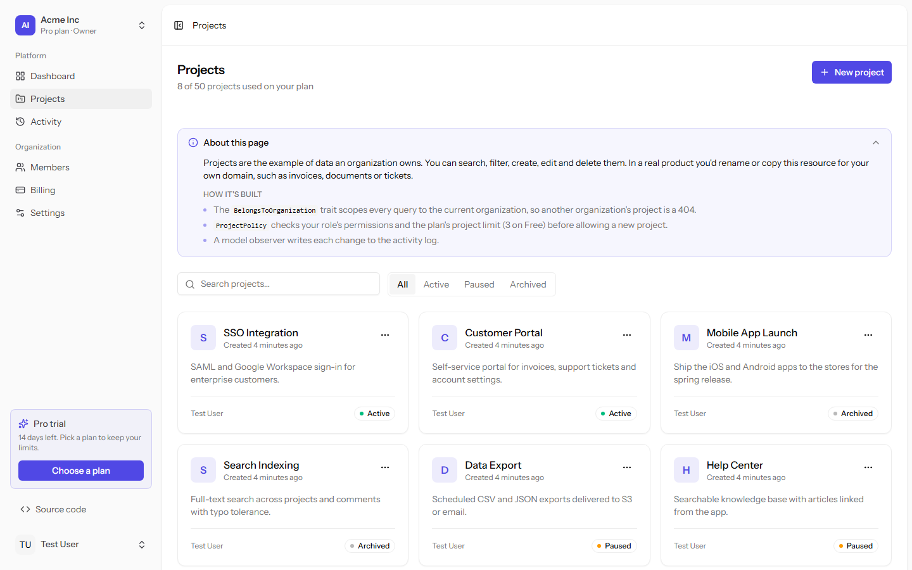
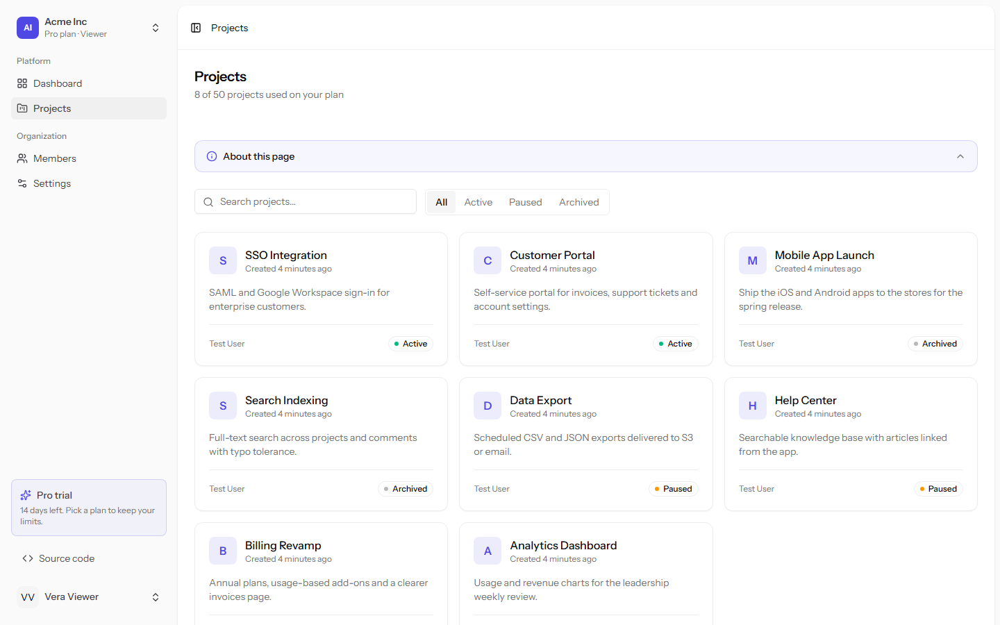
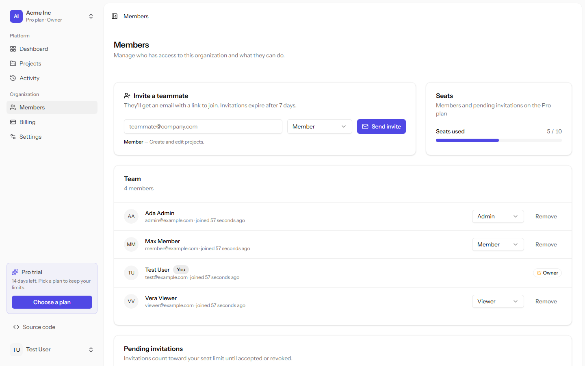
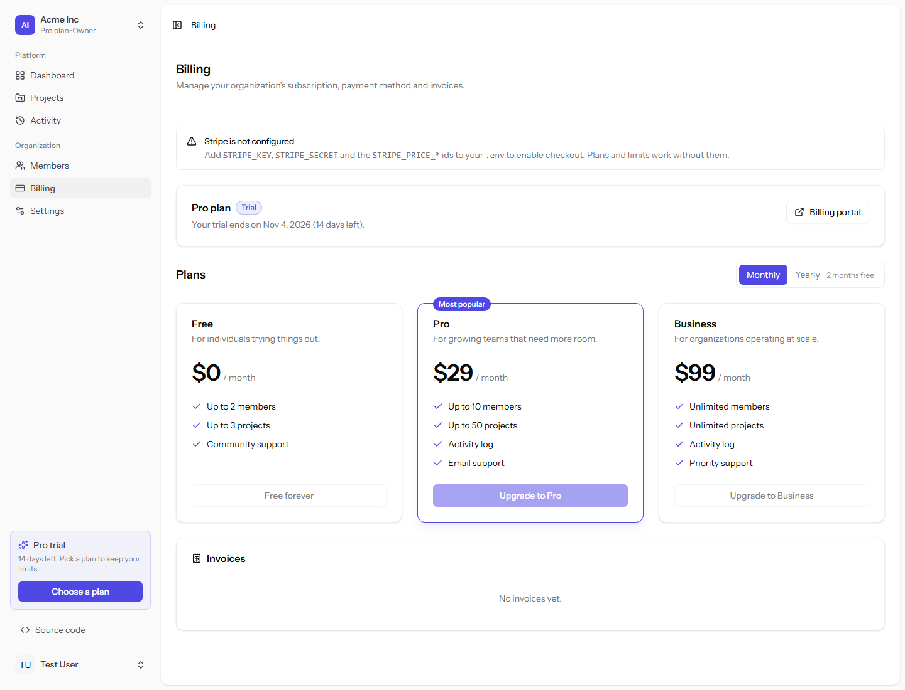
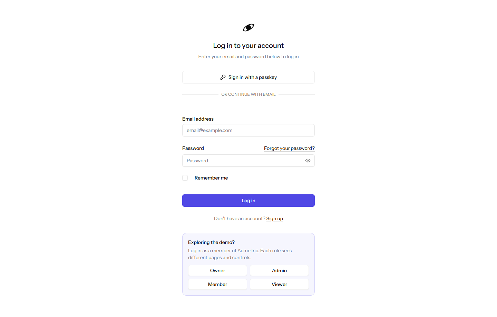

# Orbit SaaS — multi-tenant Laravel + Vue boilerplate

[](https://github.com/GodfreysDragon/orbit-saas/actions/workflows/tests.yml)
[](LICENSE)

A production-shaped starting point for B2B SaaS apps: **organizations** (multi-tenancy),
**role-based permissions** (Spatie, scoped per organization), **Stripe subscription billing**
(Laravel Cashier, billed per organization) and a polished **Inertia + Vue 3** dashboard.

Built on the official Laravel 13 Vue starter kit (Fortify auth with 2FA and passkeys,
Tailwind 4, shadcn-vue, Wayfinder typed routes).

**Live demo: [orbit-saas.onrender.com](https://orbit-saas.onrender.com)**. Log in with one click as
an Owner, Admin, Member or Viewer and subscribe with the `4242 4242 4242 4242` test card. The data
resets every hour. It runs on a free instance, so the first visit after a quiet spell can take
about a minute.



|          |                                                                            |
| -------- | -------------------------------------------------------------------------- |
| Backend  | Laravel 13, PHP 8.3+, Fortify, Cashier (Stripe), spatie/laravel-permission |
| Frontend | Vue 3 + TypeScript, Inertia 3, Tailwind 4, shadcn-vue (reka-ui), Wayfinder |
| Quality  | Pest (141 tests, 8 in a browser), Larastan level 7, Pint, vue-tsc, oxlint  |

## Features

- **Organizations**: every user gets a personal workspace on sign-up and can create or join more.
  An organization switcher in the sidebar changes the active tenant.
- **Tenant isolation**: tenant-owned models use a `BelongsToOrganization` trait that adds a global
  scope and stamps `organization_id` on create. Route model binding runs _after_ the tenant is
  resolved, so another tenant's records return 404.
- **Roles and permissions**: Owner, Admin, Member and Viewer, each mapped to granular permissions
  in a PHP enum. Spatie's _teams_ mode scopes role assignments per organization, so one user can be
  an Owner in one org and a Viewer in another.
- **Invitations**: queued email invitations with expiry, seat-limit checks, invited-email matching
  on accept, revocation, and nightly pruning of expired invitations. New invitees sign up straight
  from the link: the email is pre-filled, and because the link proves they own the inbox, the
  account is verified and joins the organization in one step, with no second verification email.
- **Billing**: Free, Pro and Business plans defined in `config/billing.php`. Includes a card-less
  14-day trial, Stripe Checkout, plan swaps, cancel and resume during the grace period, the Stripe
  customer portal, and invoices (loaded as a deferred prop).
- **Plan limits**: seat and project limits are enforced in policies and validation, and the UI
  shows an upgrade prompt.
- **Audit log**: an activity feed written by model observers, actions and a queued Cashier webhook
  listener.
- **Dashboard**: KPI tiles, a 14-day activity chart, usage meters, recent projects, an onboarding
  checklist and a trial banner. It supports dark mode, and every control is permission-aware.

## Screenshots

**Subscribing through Stripe Checkout** (test mode, recorded against a real Stripe sandbox): a
one-click demo login, then upgrading to Pro with the `4242` test card. The webhook marks the plan
Active and the paid invoice appears.


|                                                                                    |                                                                            |
| ---------------------------------------------------------------------------------- | -------------------------------------------------------------------------- |
|  |              |
| Landing page; pricing is read from `config/billing.php`                            | Dashboard in dark mode                                                     |
|                              |               |
| Projects as an **Owner**, with its "About this page" guide open                    | The same page as a **Viewer**: no create or edit controls, fewer nav items |
|                            |                                    |
| Members, roles and invitations with seat usage                                     | Billing: trial status, plan picker, portal and invoices                    |
|                   |                                                                            |
| Login with one-click demo accounts for each role                                   |                                                                            |

## Architecture

```
app/
├── Actions/Organizations/   CreateOrganization, InviteMember, AcceptInvitation, TransferOwnership, ...
├── Billing/                 Plan (value object over config/billing.php), SubscriptionSummary
├── Console/Commands/        permissions:sync (enums → Spatie tables, idempotent), demo:reset
├── Contracts/               NotTenantAware (opt a queued job out of tenant restoring)
├── Enums/                   Permission, OrganizationRole (role → permissions map), ProjectStatus
├── Http/Middleware/         EnsureOrganizationContext (resolves tenant, sets Spatie team id)
├── Listeners/               RecordSubscriptionActivity (queued, on Cashier WebhookHandled)
├── Models/
│   ├── Concerns/BelongsToOrganization.php   global scope + auto organization_id
│   ├── Scopes/OrganizationScope.php
│   └── Organization (Billable), User, Membership (pivot), Project, Activity, OrganizationInvitation
├── Notifications/           OrganizationInvitationNotification (ShouldQueue)
├── Policies/                OrganizationPolicy, ProjectPolicy (permissions + plan limits)
└── Support/
    ├── CurrentOrganization.php   request-scoped tenant context
    └── TenantAwareJobs.php       carries the tenant into queued jobs
```

### How a request is scoped

1. `auth` and `verified` run, then the `organization` middleware (`EnsureOrganizationContext`)
   resolves the user's current organization. If it is stale, the user falls back to another
   membership. If they have none, they are redirected to create an organization.
2. It stores the tenant in `CurrentOrganization` (a scoped singleton) and calls
   `setPermissionsTeamId()`, so every `can()` and `hasRole()` check is evaluated inside that
   organization.
3. Route model binding (`{project}`) runs next. The middleware priority list puts the tenant
   middleware before `SubstituteBindings`, so bindings are already tenant-filtered.
4. Controllers authorize through policies, which check permissions _and_ plan limits, e.g.
   `ProjectPolicy::create()` denies with an upgrade message at the project limit.
5. Shared Inertia props expose the current organization, role, permission list and plan.
   The `usePermissions()` composable uses them to toggle UI. The server re-checks every action.

> **Queued jobs run in the organization they were dispatched from.** `TenantAwareJobs` stores
> the tenant in the job payload and restores it before the job runs. A job fails if its
> organization was deleted in the meantime. Jobs that work across tenants implement
> `NotTenantAware`.
>
> **Without a tenant, tenant-owned models return nothing.** The organization scope fails closed,
> so a console command or a `NotTenantAware` job that forgets the tenant sees no rows instead of
> every organization's. Wrap tenant work in
> `app(CurrentOrganization::class)->runAs($organization, function () { ... })`, go through the
> organization's relations (`$organization->projects()`), or read across tenants explicitly with
> `Project::acrossOrganizations()`.

### Adding a new tenant-owned resource

1. Add a migration with `$table->foreignId('organization_id')->constrained()->cascadeOnDelete();`
2. `use BelongsToOrganization;` on the model.
3. Add permissions to `App\Enums\Permission`, grant them in `OrganizationRole::permissions()`, and
   run `php artisan permissions:sync`.
4. Write a policy using `$user->hasPermissionIn($organization, Permission::...)`.

`Project` is the reference implementation (model, observer, policy, controller, Vue page, tests).

## Getting started

Requirements: PHP 8.3+ (with `pdo_sqlite`), Composer, Node 22+.

```bash
composer run setup        # install, .env, key, migrate, permissions:sync, build
php artisan db:seed       # demo data (optional)
composer run dev          # server + queue worker + vite
```

### Demo accounts (after seeding)

All passwords are `password`. Everyone belongs to **Acme Inc** (on a Pro trial) and has their own
personal workspace. The login page has one-click buttons for each role.

Every page also shows a collapsible **About this page** guide explaining what it does and how it's
built. Set `APP_PAGE_GUIDES=false` to hide the guides and the demo login buttons when building a
real product.

| Email              | Role in Acme Inc |
| ------------------ | ---------------- |
| test@example.com   | Owner            |
| admin@example.com  | Admin            |
| member@example.com | Member           |
| viewer@example.com | Viewer           |

### Stripe setup

The app runs without Stripe: plans, trials and limits all work. To enable checkout:

1. Create two products in Stripe (Pro, Business), each with a monthly and a yearly recurring price.
   No account yet? `stripe sandboxes create --email you@example.com` provisions a claimable test
   sandbox and logs the CLI in to it.
2. Fill in `.env`:
    ```dotenv
    STRIPE_KEY=pk_test_...
    STRIPE_SECRET=sk_test_...
    STRIPE_WEBHOOK_SECRET=whsec_...
    STRIPE_PRICE_PRO_MONTHLY=price_...
    STRIPE_PRICE_PRO_YEARLY=price_...
    STRIPE_PRICE_BUSINESS_MONTHLY=price_...
    STRIPE_PRICE_BUSINESS_YEARLY=price_...
    ```
3. Forward webhooks locally. `stripe listen --print-secret` prints the value for
   `STRIPE_WEBHOOK_SECRET`; then run:
    ```bash
    stripe listen --forward-to localhost:8000/stripe/webhook --events customer.subscription.created,customer.subscription.updated,customer.subscription.deleted,customer.updated,customer.deleted,payment_method.automatically_updated,invoice.payment_action_required,invoice.payment_succeeded
    ```
    Cashier keeps the `subscriptions` table in sync, and the app logs each change to the audit log.
    In production, `php artisan cashier:webhook` registers the same events.
4. Enable the Customer Portal in the Stripe dashboard (or create a portal configuration through
   the API) so the **Billing portal** button can open it.

Checkout with the `4242 4242 4242 4242` test card, webhook sync, plan swaps, cancel and resume,
the customer portal and invoices have all been verified end to end against a Stripe sandbox.

Subscriptions are keyed on `organization_id` (`Cashier::useCustomerModel(Organization::class)`),
and the organization owner's email is used as the Stripe customer email.

## Testing and quality

```bash
npx playwright install chromium   # once, for the browser tests
npm run build                     # browser tests use the built assets
php artisan test            # Pest feature and browser tests
composer run types:check    # Larastan level 7
composer run lint           # Pint
npm run check               # oxlint + formatting
npm run types:check         # vue-tsc
```

The test suite covers tenant isolation (including cross-tenant route binding), per-organization
role resolution, the full permission matrix, the invitation lifecycle and seat limits, member
management rules (the owner can't be removed, users can't change their own role), ownership
transfer, organization deletion, plan resolution from Stripe prices, plan-limit enforcement,
past-due handling, webhook activity logging, tenant restoring in queued jobs and demo mode.
Browser tests (Pest's Playwright plugin, in `tests/Browser`) drive the real Vue app through the
organization switcher, invite and sign-up, ownership transfer and the billing UI.

## Deployment notes

- Run `php artisan permissions:sync` on every deploy (it is idempotent).
- Run a queue worker (`php artisan queue:work`) for invitation emails and webhook listeners.
- Schedule `php artisan schedule:run` every minute; it prunes expired invitations daily.
- The Stripe webhook route (`/stripe/*`) is excluded from CSRF checks and verified by its signature.
- Behind a load balancer that terminates TLS, set `TRUSTED_PROXIES` (`*` or a list of addresses).

### Public demo on Render

[](https://render.com/deploy?repo=https://github.com/GodfreysDragon/orbit-saas)

`render.yaml` deploys the `Dockerfile` as one free web service. It runs Apache with mod_php and keeps
SQLite inside the container, with a sync queue and log mail. `docker/entrypoint.sh` seeds the
database on boot, caches the config and runs the scheduler alongside Apache. To try the image
locally:

```bash
docker build -t orbit-saas .
docker run -p 8080:8080 -e APP_DEMO=true -e SESSION_DRIVER=cookie orbit-saas
```

`APP_DEMO=true` turns on demo mode for a deployment where visitors share the seeded accounts:

- The demo accounts can't change their email or password, set up two-factor or passkeys,
  delete themselves, or transfer or delete Acme Inc (`ProtectDemoAccounts` middleware).
- New sign-ups are verified straight away, because the demo sends no email.
- `demo:reset` rebuilds the data every hour. It builds a new SQLite file and swaps it in, so
  requests never see a half-built database.

Free instances sleep when idle, so the first request can take about a minute. Every boot starts
from fresh seed data. For billing, enter the Stripe test keys and price IDs when you create the
Blueprint. Then add a webhook endpoint for `https://<your-app>.onrender.com/stripe/webhook`, using
the events from `php artisan cashier:webhook`, and set its signing secret as `STRIPE_WEBHOOK_SECRET`.

## Roadmap

Known limitations, finished work and planned features (per-seat and metered billing, API tokens,
activity log filters and more) are tracked in [docs/ROADMAP.md](docs/ROADMAP.md).

## License

[MIT](LICENSE)
